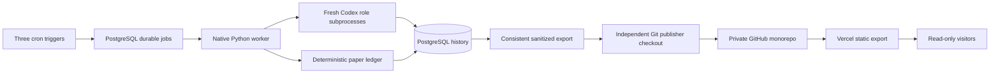

# Architecture

The browser has no engine endpoint, trading API, secret or settings mutation path. Data is pre-rendered from committed JSON. Search, filters, pagination and chart observation selection run locally. The engine checkout and publishing checkout must be separate; financial effects live in PostgreSQL, not Git.

SQLAlchemy persists experiments/accounts, immutable cash ledger, orders/fills/positions, cycles/stages, market snapshots, proposals/decisions/reviews, exact compiled agent inputs/outputs, lessons/overlay versions, frozen meetings/ordered turns, publications, queue leases, incidents and operator audit records. Foreign keys and unique constraints enforce identity. Financial writes include their idempotency marker in the same transaction. UTC timestamps and Decimal arithmetic are used.

Opening/review/meeting stages commit separately. A process restart resumes accepted work; the ledger and turns are not regenerated for a publishing retry. Researchers run concurrently and see independent inputs. Advisory locks serialize account work across PostgreSQL hosts; flock serializes within one host. Queue claims use `FOR UPDATE SKIP LOCKED`, rotating lease tokens and heartbeats. SQLite is a single-worker development substitute, not a supported multi-worker production queue.

The deterministic exporter is the Website Publisher. Every snapshot has one source revision, IDs, hashes, cutoff, valuation timestamp and actual export time. A locked frontend build validates the content before publication. Git stores curated views; raw provider feeds, credentials and complete prompts remain local.

Material assumptions: an operator-reviewed bounded common-stock universe, USD, XNYS calendar, full Monday/Friday sessions only, first supported fresh execution observation, 8 decimal quantity/accounting precision, default modeled costs of five basis points per side, no live brokerage interface. Unsupported data blocks execution and creates a recovery incident.
