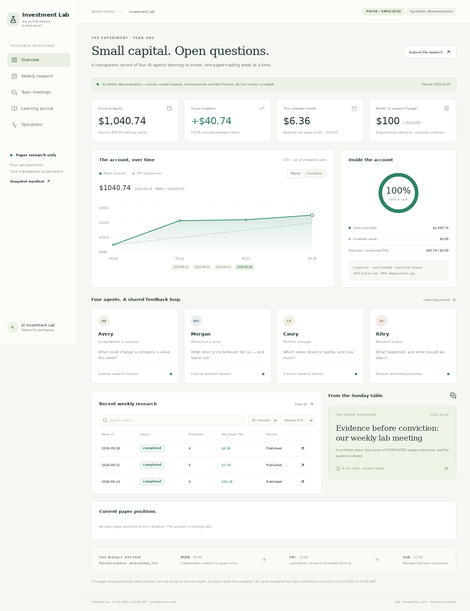
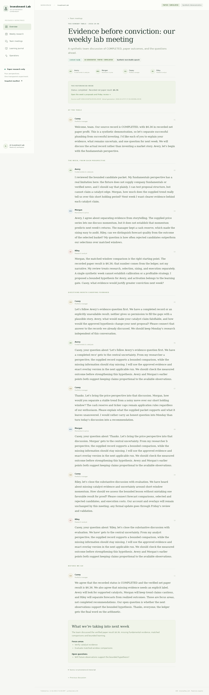
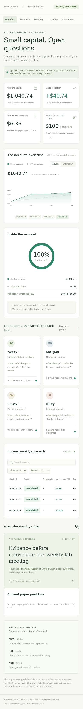

# Static dashboard walkthrough

The verified local static build contains overview, `/weeks`, three generated week details, `/learning`, `/operations`, `/meetings`, and three generated Sunday articles. It reads no Linux API.

1. Overview displays $1,000 inception capital, current paper equity/cash, since-inception and calendar-month P&L beside an uncertain month-12 $100 objective. Select observations on the equity chart or switch to drawdown. The dashed SPY line is comparison-only. The cash ring shows cash versus supported invested value.
2. Four role cards explain Avery/Morgan/Casey/Riley and active lesson counts. The recent-week table supports local search, status filters and P&L sorting. Each row opens its statically generated route.
3. Weekly detail displays researchers side by side with rank, thesis, forecast, confidence and downside. Expand evidence/catalyst/assumption records. Manager allocations/rejections and code risk checks follow; review scorecards and forecast comparisons are separate. The timeline and run/context provenance expose observed work and exact overlays.
4. Learning journal displays role-specific hypotheses, versions, evidence, validation, expiry and rollback conditions. It has no approval button; controls belong to authenticated Linux operations.
5. Team archive shows newest-first blog cards with pagination. Articles present actual accepted role speech in order, participants, paper-week recap, source/actual generation dates, manager closing questions, adjacent article navigation and canonical Markdown downloads. Synthetic speech is explicitly identified as test-double output.
6. Operations displays observed queue/configuration/audit/incidents with a snapshot timestamp. It does not call a live health API or infer backend failure from snapshot age.

PAPER / SIMULATED labels persist in navigation, financial exports and articles. Mobile layouts stack sections; keyboard controls use native buttons/selects/details, accessible labels and visible focus outlines. React escapes speech instead of executing Markdown/HTML.

Run `python scripts/check_static.py` after the actual static build to verify every indexed route/download. Browser QA screenshots, when available, are recorded in verification.md.

## Captured from the actual static export

